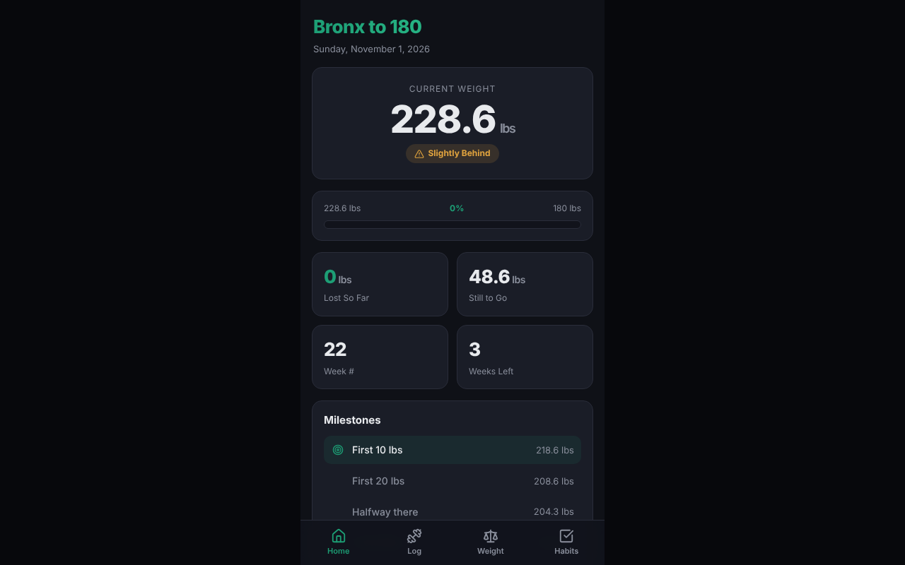
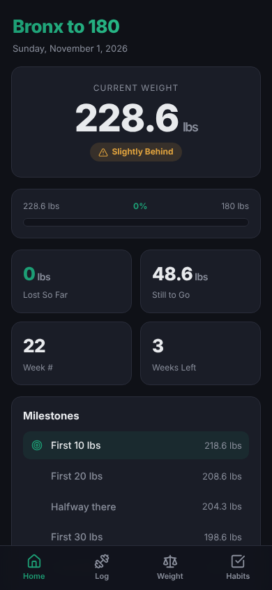

<picture>
  <source media="(prefers-color-scheme: dark)" srcset=".github/readme/banner-dark.svg">
  <source media="(prefers-color-scheme: light)" srcset=".github/readme/banner-light.svg">
  
</picture>

<p align="center">
  <a href="https://cop1ouss.github.io/bronx-to-180/"></a>
</p>
<p align="center">
  
  
  
  
</p>

<p align="center">
  
  &nbsp;
  
</p>

A personal, mobile-first fitness tracker for one goal: get from **228.6 lbs → 180 lbs** by **November 21, 2026**.

Track your weight, log workouts, and check off daily habits — all stored locally in your browser. No backend, no accounts, no API.

## Features

- **Home** — current weight, animated progress bar, lost/remaining/week stats, milestone tracker, recent workouts, and an "on track" badge.
- **Log** — record workouts (type, duration, notes), browse full history, delete entries.
- **Weight** — log weigh-ins, see day-over-day change, and a Recharts line chart of actual weight vs. target pace.
- **Habits** — 5 daily habit toggles with a score badge and a last-7-days bar chart.

All data persists in `localStorage` under the keys `b180_workouts`, `b180_weights`, and `b180_habits`.

## Tech Stack

- [React 19](https://react.dev/) + [Vite](https://vite.dev/)
- [React Router](https://reactrouter.com/) (HashRouter, for clean GitHub Pages routing)
- [Recharts](https://recharts.org/) for charts
- [lucide-react](https://lucide.dev/) for icons
- Plain CSS (dark theme, mobile-first, max-width 430px)

## Run Locally

```bash
npm install
npm run dev
```

Then open the printed local URL (typically http://localhost:5173/bronx-to-180/).

## Deploy to GitHub Pages

1. In `package.json`, replace `YOUR_GITHUB_USERNAME` in the `homepage` field with your GitHub username.
2. Make sure the repository is named `bronx-to-180` (matches `base` in `vite.config.js`).
3. Run:

```bash
npm run deploy
```

This builds the app and publishes the `dist/` folder to the `gh-pages` branch. Your app will be live at `https://YOUR_GITHUB_USERNAME.github.io/bronx-to-180/`.

## Customizing

Your goal, dates, habits, workout types, and milestones all live in [`src/utils/constants.js`](src/utils/constants.js). Seed data lives in [`src/utils/defaults.js`](src/utils/defaults.js).

---

<p align="center"><sub>Part of <a href="https://github.com/Cop1ouss">Uncook</a> · built off systems · © 2026 Dajoni Gomez</sub></p>
